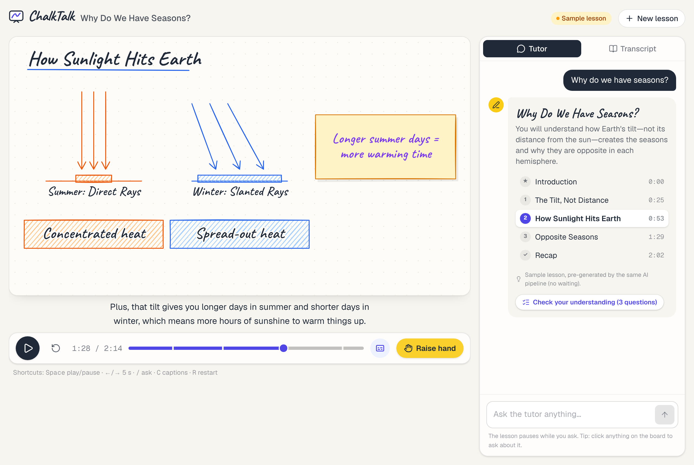
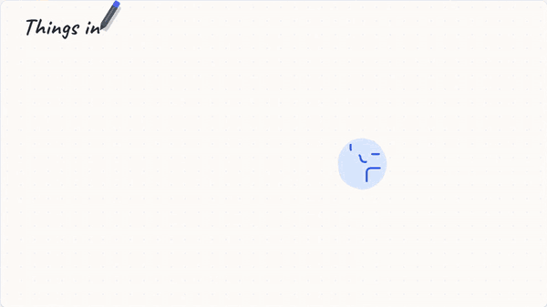
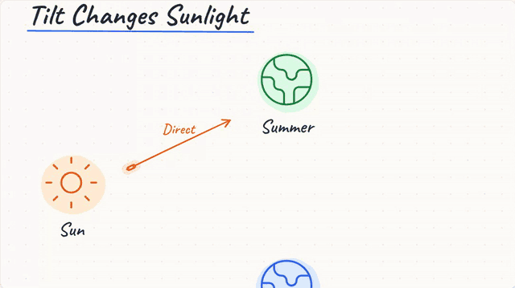
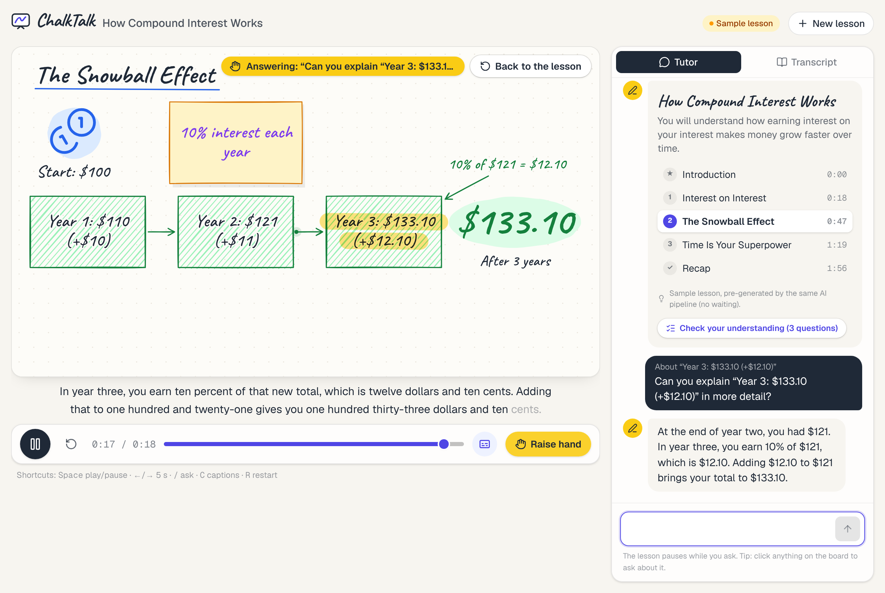
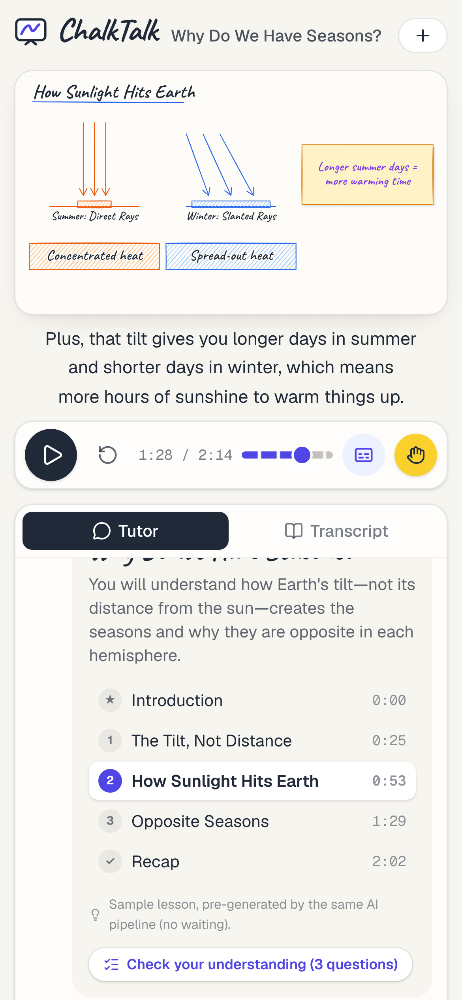
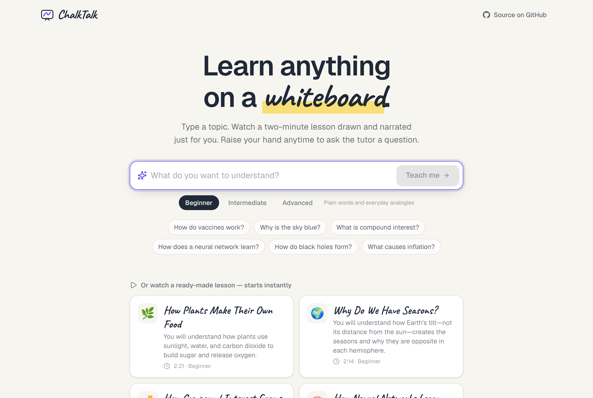
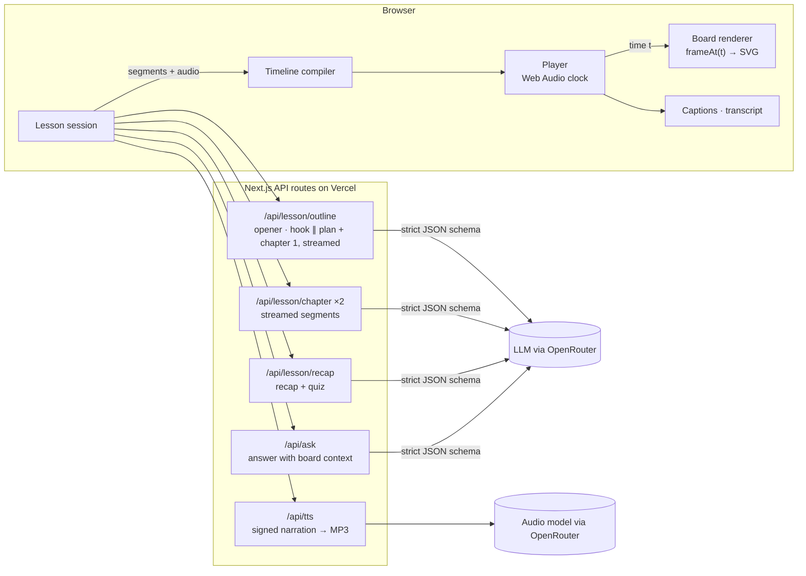

<div align="center">

# ChalkTalk

**Learn anything on a whiteboard.**
Type a topic, watch a two-minute lesson drawn and narrated just for you, and raise your hand at any moment — the tutor answers out loud, on the same board.

**[▶ Live demo](https://chalktalk-delta.vercel.app)** · [How it works](#how-it-works) · [Run it locally](#run-it-locally) · [Architecture notes](docs/ARCHITECTURE.md)



</div>

---

## Why

When you hit a concept you don't get — photosynthesis, binary search, compound interest — the best explanation is usually a teacher at a whiteboard: short, spoken, drawn step by step. Chatbots answer with walls of text. Videos are visual, but they can't answer *your* question at the moment you get lost, and there may be no video for your exact topic and level.

ChalkTalk combines the three things a great teacher does:

1. **Explains while drawing** — narration and drawings are generated together, and every stroke starts on the word that introduces it.
2. **Can be interrupted** — pause anywhere, point at anything on the board, and ask. The tutor answers by annotating the board you're looking at, then picks up where it stopped.
3. **Checks understanding** — a three-question quiz at the end; wrong answers link straight back to the part that explains it.

It's built for self-directed learners (high-school and university students, and curious adults) and works best for conceptual "how / why" topics.

## Features

- **Chat-first**: type any topic, pick Beginner / Intermediate / Advanced, or open a ready-made lesson that starts instantly.
- **~2-minute lessons**: a hook, three short chapters (one whiteboard each) and a recap — written live by an LLM.
- **A real whiteboard**: hand-drawn, colour-hatched boxes and circles, sticky notes, ~200 line-art drawings, the tutor's **own sketches** (figures built from simple shapes when no ready-made drawing fits, like sun rays hitting the ground straight on or at a slant), arrows, step-by-step flows, cycles, timelines, function plots, bar and pie charts, comparison tables and key numbers, plus annotations (highlight, circle, underline, cross out, tick, callouts, pulse).
- **Demonstrations, not just diagrams**: things move the way they do in real life. The Earth orbits the sun, a pendulum swings, gears turn, gas molecules jiggle (faster when hot), an object glides to where it's going and a quantity grows.

  
- **A board that moves**: a gentle camera follows the pen and pulls back to show the whole board; packets flow along arrows so you see which way things go; things travel across the board (a water drop up to the leaf, energy from the sun); bars grow, pie slices sweep open and numbers count up; things pop in and bump when the tutor points at them. Still a steady 60 fps, and calm with reduced motion.

  
- **Voice in sync with the board**: each drawing is tied to a cue phrase in the narration; captions highlight the words as they're spoken.
- **Full playback control**: play, pause, resume, seek (chapter markers, keyboard, or click any line of the transcript), restart. Pausing mid-stroke freezes the stroke half-drawn — the board is exact at every moment.
- **Raise your hand**: questions get a spoken answer drawn on top of the current board (or a fresh mini-board), with the lesson context and what's on the board at that moment. Click any element on the board to ask about it.
- **Honest AI**: live vs. pre-generated content is labelled, low-confidence answers say so, and unsafe topics are declined politely.

<table>
  <tr>
    <td width="68%"><br><sub><b>Raise your hand:</b> click anything on the board and ask — the answer is drawn right on it.</sub></td>
    <td width="32%"><br><sub><b>Phones too:</b> same lesson, stacked layout.</sub></td>
  </tr>
  <tr>
    <td colspan="2"><br><sub><b>Chat-first:</b> type a topic and pick a level, or start a ready-made lesson instantly.</sub></td>
  </tr>
</table>

## A two-minute tour

1. Open the [demo](https://chalktalk-delta.vercel.app) and click a **ready-made lesson** — it starts instantly.
2. Drag the seek bar (or press <kbd>←</kbd>/<kbd>→</kbd>), pause in the middle of a drawing, open the **Transcript** tab and click a sentence.
3. Click something on the board (e.g. a label) and send the suggested question — watch the answer appear on the board, then press **Back to the lesson**.
4. Go back and type your own topic — the tutor starts talking within a few seconds while the rest of the lesson is still being written.
5. At the end, take the quiz.

Keyboard: <kbd>Space</kbd> play/pause · <kbd>←</kbd>/<kbd>→</kbd> ±5 s · <kbd>/</kbd> ask · <kbd>C</kbd> captions · <kbd>R</kbd> restart · <kbd>Esc</kbd> back to the lesson.

## What's live and what isn't

| Part | How it's produced |
| --- | --- |
| Lesson plan, narration, drawings, recap, quiz | **Live** — generated per request by an LLM (default `google/gemini-4-hydrogen` via OpenRouter) |
| Narration audio | **Live** — synthesised per line by Gemini TTS (`google/gemini-3.8-flash-tts`, voice `Sulafat`) via OpenRouter, with an OpenRouter audio model (`openai/gpt-audio-mini`) as the backup voice |
| Answers to your questions | **Live** — generated with the lesson and the current board as context, then voiced |
| The whiteboard drawing | Rendered by ChalkTalk's own engine from the model's board instructions (deterministic code, not images) |
| "Ready-made lessons" on the home page | **Pre-generated** with exactly the same pipeline and stored as static JSON + MP3 files, so they start instantly and work even if the AI service is down. They're labelled "Sample lesson". |
| Captions-only playback | Fallback when a line can't be voiced; the lesson continues with captions |

## How it works



**1. A board language, not coordinates.** The model writes a small "board script": narration split into one-to-two-sentence segments, each with drawing actions such as `{ kind: "flow", items: [...], at: {col, row, w, h}, cue: "two-step process" }`. It decides *what* to draw and *when* (the cue phrase); ChalkTalk decides *where* and *how*. The schema is enforced with structured outputs, then a repair pass makes every action sensible (speakable narration, valid ids and references, known icons, cues that really occur in the narration).

**2. A layout engine.** Elements are placed on a 12 × 6 grid under the title. Overlaps are resolved by moving elements to the nearest free cells, text is fitted with font metrics measured from the handwriting font, and arrows attach to facing edges (two arrows between the same pair run side by side; elements too close for a straight arrow get a curved one around the side). Composites (lists, flows, cycles, timelines, plots, bar and pie charts, tables) are laid out by code. The model's own sketches are parsed from numbers into fresh paths, so nothing it writes reaches the page as markup. Strokes and colour hatching are generated with rough.js using a fixed seed per element, so the sketchy look never "boils" between frames. A planned virtual camera (a pure function of time, like everything else) eases in on whatever is being drawn and back out to the whole board.

**3. The board is a function of time.** A timeline compiler turns segments + measured audio durations into absolute start times for every stroke. Within a segment, a cue's time is estimated from its position in the text, weighted for the pauses punctuation adds. The renderer is a pure function, `frameAt(timeline, t)`, evaluated every animation frame from the **audio hardware clock** (compensating for output latency). Demonstrations are too: an orbit, a swing or a cloud of particles is computed from `t` (particles from a seeded random generator), never stepped by a simulation. Pause, seek, restart, background tabs and Bluetooth delay can't drift out of sync because nothing runs on timers.

**4. No waiting.** The tutor's first words don't wait for any model: a short opening line built from your topic is voiced the moment you click. Meanwhile two model calls run in parallel: a tiny "hook" (the opening question and a hero drawing) and one call that writes the lesson plan *and then* chapter 1. The plan is sent to the browser the moment its part of the JSON closes, which starts chapters 2 and 3 right away, while chapter 1 keeps streaming from the same call. Each line's narration goes out as soon as its text is written, before its drawings, so it's being voiced while the model is still drawing. Lines are voiced in lesson order (the next ones to be heard jump the queue) and travel as small MP3s (25–75 KB each). The player plays up to the "ready" edge and waits there only if it catches up. In production, on a connection throttled to 3 Mbps, the tutor starts talking about 4 s after you click and every chapter is voiced within about 30 s, long before playback reaches it.

**5. Voice you can trust.** The narrator is Gemini TTS (through OpenRouter's speech endpoint), a true text-to-speech model that reads the script verbatim. If it's unavailable, an audio chat model takes over; because that one is conversational, ChalkTalk compares its transcript with the script, trims ad-libbed endings at the nearest pause and retries real mismatches. If no server voice is available at all, the browser's own voice reads the lesson. The speech endpoint only voices text signed (HMAC) by the server that generated it — the signature includes the voice — and responses are immutable and CDN-cacheable.

**6. Answers on the board.** A question pauses the lesson and is sent with the lesson plan, what was just said, the elements currently on the board (ids and labels), the element you pointed at, and the recent conversation. The tutor chooses to annotate the current board, draw a fresh mini-board, or reply in chat — and its answer plays as a small timeline layered over the frozen board.

More detail, including the data model and the player state machine: **[docs/ARCHITECTURE.md](docs/ARCHITECTURE.md)**.

## Learning design

The core interactions follow well-established multimedia-learning principles (Mayer):

| Principle | In ChalkTalk |
| --- | --- |
| Temporal contiguity — show visuals while they're described | Every drawing starts on its cue phrase |
| Signalling — point at what matters | Highlights, circles, underlines and callouts at the moment of mention |
| Segmenting — learner-paced chunks | Three short chapters, pause/seek anywhere, chapter markers |
| Modality — explain in speech, not paragraphs | Narration carries the explanation; board labels are ≤ 5 words |
| Coherence — cut the clutter | One idea per board, 4–9 elements |
| Retrieval practice | End-of-lesson quiz with "rewatch this part" links |

Each lesson also tackles the topic's most common **misconception** explicitly: the wrong idea is drawn, crossed out, and replaced by the right one.

## Tech stack

- **Next.js 16** (App Router, route handlers, streaming responses) · **React 19** · **TypeScript** · **Tailwind CSS 4**
- **zod** for the board-script schema, validation and JSON-Schema export for structured outputs
- **rough.js** (hand-drawn strokes), **Lucide** (line-art drawings), **Caveat** (handwriting font)
- **Web Audio API** for sample-accurate, gapless narration and the master clock; **LAME in WebAssembly** (`wasm-media-encoders`) to send speech as small MP3s
- **OpenRouter** for every model: the lesson model, Gemini TTS for the narrator and the backup voice
- **Vitest** for the engine, player and pipeline tests · deployed on **Vercel**

## Run it locally

Requirements: Node.js 20+, pnpm, and an [OpenRouter API key](https://openrouter.ai/keys).

```bash
git clone https://github.com/zynoxprince/ChalkTalk.git
cd ChalkTalk
pnpm install
cp .env.example .env.local      # then put your OpenRouter key in OPENROUTER_API_KEY
openssl rand -hex 32            # paste the output into SIGNING_SECRET
pnpm dev                        # http://localhost:3000
```

Other scripts:

| Command | What it does |
| --- | --- |
| `pnpm test` | Unit tests (layout, drawing tools and motions, timing, `frameAt`, player state machine, streaming parsers, repair, speech checks) |
| `pnpm lint` / `pnpm typecheck` | ESLint and TypeScript |
| `pnpm build` | Production build |
| `node scripts/generate-samples.mjs [slug]` | Regenerates the ready-made lessons through a running server (`BASE_URL`, default `http://localhost:3000`; needs `ffmpeg`) |
| `node scripts/gen-icons.mjs` | Regenerates the curated icon set the model may draw |

Visit **`/playground`** to see the whiteboard engine play a hand-written lesson with no AI at all (append `?t=12.5` to freeze a moment, or `?sample=seasons` to inspect a sample's boards).

### Configuration

| Variable | Required | Default | Purpose |
| --- | --- | --- | --- |
| `OPENROUTER_API_KEY` | yes | — | Key for all model calls (server-side only) |
| `SIGNING_SECRET` | yes | — | Random string used to sign narration for the speech endpoint |
| `LESSON_MODEL` | no | `google/gemini-4-hydrogen` | Writes plans, chapters, recaps and quizzes |
| `TUTOR_MODEL` | no | `LESSON_MODEL` | Answers questions |
| `LESSON_REASONING` / `TUTOR_REASONING` | no | `minimal` | Reasoning effort; lower is faster |
| `TTS_MODEL` | no | `google/gemini-3.8-flash-tts` | Narrator: any OpenRouter text-to-speech model (`google/gemini-3.8-flash-lite-tts` is faster), or an audio chat model such as `openai/gpt-audio-mini` |
| `TTS_VOICE` | no | `Sulafat` | Narrator voice (for Gemini: `Achird`, `Kore`, `Charon`, …) |
| `TTS_STYLE` | no | a warm, upbeat teacher | Delivery direction for models that take one |
| `BACKUP_TTS_MODEL` | no | `openai/gpt-audio-mini` | Reads a line if the narrator fails (`none` to turn off) |
| `BACKUP_TTS_VOICE` | no | `marin` | Voice for the backup narrator |

The lesson model must support structured outputs on OpenRouter. All models, including the voices, are called through OpenRouter, so one key is enough (with OpenRouter's BYOK, calls to Google models can use your own Google key). Without any working voice, lessons still play: the browser's built-in voice reads them.

## Project structure

```
src/
  app/                    Next.js routes: the app, /playground, and /api/*
  components/
    app/                  Landing, lesson view, board stage, side panel, quiz
    board/                SVG whiteboard renderer
    player/               Controls (seek bar with chapters) and captions
  lib/
    board/                Engine: layout, text metrics, rough strokes, icons, plots, timeline, frameAt
    player/               Playback state machine (Web Audio clock) and audio helpers
    lesson/               Board-script schema, prompts, generation, repair, streaming JSON parser
    client/               Browser-side lesson session (streams, voice queue, timeline updates)
    server/               OpenRouter client, speech verification, signing, rate limits
scripts/                  Sample-lesson and icon generators
public/samples/           Pre-generated lessons (JSON + MP3)
tests/                    Vitest suites
```

## Privacy and safety

- No accounts and no stored personal data. Topics and questions are sent to the AI provider to generate the lesson.
- API keys live only in server environment variables; the browser never sees them.
- The speech endpoint only voices server-signed narration; all endpoints validate input sizes and are rate-limited per client.
- Model output is rendered as data, never as HTML: text is escaped, icons come from an allowlist, and plots use a small safe expression parser (no `eval`).
- Harmful topics are declined with a short explanation.

## Accessibility

Keyboard shortcuts for every control, a proper ARIA slider for seeking, visible focus states, captions on by default, a full clickable transcript as a text alternative to the board, and `prefers-reduced-motion` support in the interface.

## Known limitations

- **Timing inside a line is estimated.** Segment boundaries are exact (measured audio), but a cue's position inside a sentence is estimated from the text (typically within a few tenths of a second). Word-level timestamps would make it exact.
- **Each line is voiced separately**, so tone can vary slightly from line to line; the backup narrator is a conversational model whose output is checked against the script.
- **AI can be wrong.** Lessons are not fact-checked against sources; low-confidence answers are flagged, but treat lessons as explanations, not references.
- **Crowded boards happen occasionally.** The layout engine prevents overlapping elements, but arrows can still cross other things on busy boards.
- **Sketches are schematic.** The tutor draws its own figures from a few simple shapes, which suits physics and geometry better than anatomy or maps.
- **Live lessons aren't saved or shareable yet**, and rate limits are in-memory per server instance.
- English-first: the handwriting font covers Latin scripts; other scripts fall back to system fonts.

## Roadmap

- Word-level alignment for exact cue timing
- Save and share lessons; "explain it differently" for a single chapter
- A "your turn" mode: the learner sketches on the board and a vision model gives feedback
- Playback speed (time-stretching), more voices and languages
- Spaced-repetition review of quiz questions

## License

[MIT](LICENSE)

## Acknowledgements

[rough.js](https://roughjs.com/) (MIT) for the hand-drawn strokes, [Lucide](https://lucide.dev/) (ISC) for the line-art drawings, [Caveat](https://fonts.google.com/specimen/Caveat) (SIL OFL) for the handwriting, and [OpenRouter](https://openrouter.ai/) for model access. This project was built with the help of AI coding tools.
