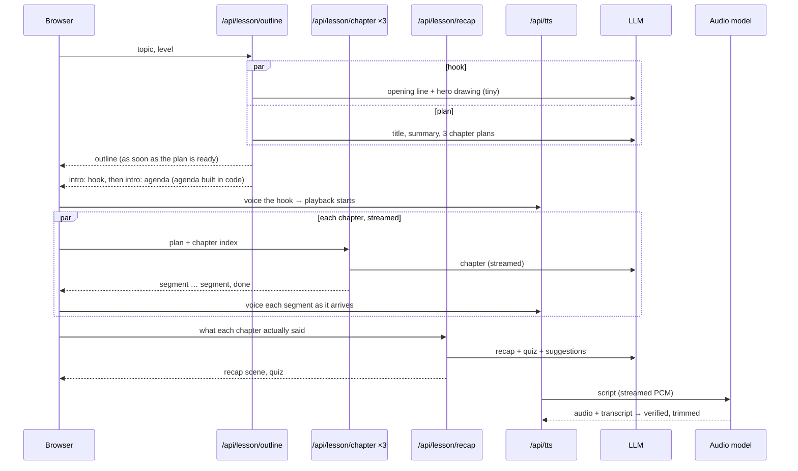
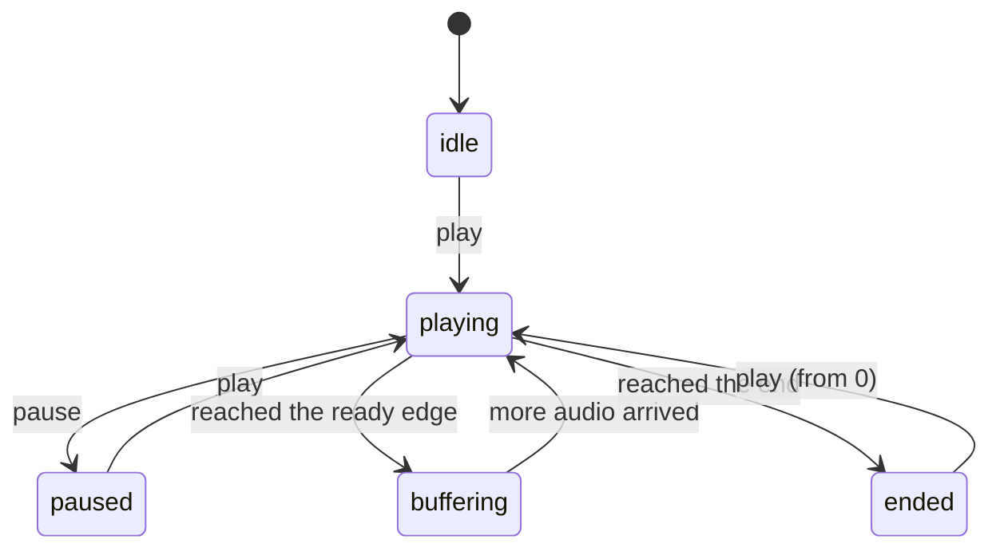

# ChalkTalk architecture

This document explains how a topic becomes a narrated, hand-drawn lesson, and why the main pieces are built the way they are. For a feature overview, see the [README](../README.md).

- [1. Request flow](#1-request-flow)
- [2. The board script](#2-the-board-script)
- [3. Layout engine](#3-layout-engine)
- [4. Timeline and synchronisation](#4-timeline-and-synchronisation)
- [5. Rendering](#5-rendering)
- [6. Player](#6-player)
- [7. Streaming generation](#7-streaming-generation)
- [8. Voice](#8-voice)
- [9. Tutor answers](#9-tutor-answers)
- [10. Failure handling](#10-failure-handling)
- [11. Testing](#11-testing)

## 1. Request flow



The browser orchestrates (`src/lib/client/session.ts`): it knows what is still missing, retries individual chapters, reports progress, and keeps each serverless call short. All model calls happen on the server, so the API key never reaches the browser.

## 2. The board script

The model never outputs coordinates in pixels or SVG. It writes a small, typed board script (`src/lib/lesson/schema.ts`):

```jsonc
{
  "narration": "Picture a leaf in sunlight. It takes in light from the sun, water from the roots, and carbon dioxide from the air.",
  "actions": [
    { "id": "leaf", "kind": "icon", "icon": "leaf", "text": "Leaf", "at": { "col": 5, "row": 2, "w": 2, "h": 2 }, "cue": "Picture a leaf", "color": "green" },
    { "id": "sun",  "kind": "icon", "icon": "sun",  "text": "Light", "at": { "col": 1, "row": 0, "w": 2, "h": 2 }, "cue": "light from the sun", "color": "orange" },
    { "id": "a1",   "kind": "arrow", "from": "sun", "to": "leaf", "cue": "light from the sun" }
  ]
}
```

| Group | Kinds |
| --- | --- |
| Elements (take space) | `text`, `note`, `box`, `circle`, `icon`, `list`, `flow`, `cycle`, `plot` |
| Connectors | `arrow`, `line` |
| Annotations (target an element, or `id[index]` for a part of a list/flow/cycle) | `highlight`, `circle_around`, `underline`, `cross_out`, `check`, `callout`, `trace` |

Design choices:

- **Flat actions with nullable fields** instead of a discriminated union. Every field is always present (`null` when unused), which strict structured-output modes accept across providers. Per-kind rules are enforced afterwards.
- **zod is the single source of truth.** `toStrictJsonSchema()` converts the zod schema into the strict JSON Schema sent with each request (all properties required, `additionalProperties: false`, nullables as type unions), and the same zod schema validates the response.
- **Repair, not rejection** (`src/lib/lesson/repair.ts`). After validation, each action is made sensible: narration is stripped of anything unspeakable, ids are sanitised and de-duplicated, actions missing required fields are dropped, label lengths are capped, icon names are resolved through aliases (`water` → `droplet`), and if a cue phrase doesn't occur in the narration it is re-anchored to the element's label when that is spoken.

## 3. Layout engine

`src/lib/board/layout.ts` turns actions into drawable elements on a 1600 × 900 board:

1. **Grid placement.** A title band on top, then a 12 × 6 grid. An element goes where the model asked if those cells are free; otherwise to the nearest free slot of the same size (shrinking gradually if needed). The model's spatial intent is respected while overlaps are prevented.
2. **Text fitting.** Widths come from a per-glyph table measured from the handwriting font in a browser (with a small safety margin), so layout is deterministic and testable without a DOM. Text shrinks and wraps to fit its box.
3. **Composites.** Lists, flows (horizontal or vertical depending on the box), cycles (nodes on an ellipse, arcs trimmed outside the nodes) and plots (axes, a curve sampled from a safe expression parser, robust y-range) are laid out by code and broken into sub-elements (`flow.2`, `flow.a1`, …) that can be targeted and revealed one by one.
4. **References.** Arrows and annotations resolve targets by id, by `id[index]`, or by label text. Unknown references are dropped with a warning (visible in `/playground`) rather than drawn wrongly.
5. **Hand-drawn strokes.** rough.js's generator is DOM-free, so sketchy paths are computed once during layout with a fixed seed per element; frames never re-randomise.

Each element is a list of **parts** (`stroke`, `fill`, `text`, `icon`, `dot`), each revealed during a sub-interval `[a, b]` of the element's progress. A labelled box, for example, draws its outline during `[0, 0.55]` and writes its label during `[0.45, 1]`.

## 4. Timeline and synchronisation

`src/lib/board/timeline.ts` compiles scenes plus audio durations into absolute times:

- **Segments** are laid end to end: start = previous end + 0.35 s (1.1 s between boards, with an erase animation in that gap). Durations come from the decoded audio, so segment boundaries are exact.
- **Cues inside a segment.** An action starts at `segment.start + f · duration − 0.15 s`, where `f` is the fraction of the narration spoken before the cue phrase. `f` is weighted by how long characters take to say: letters 1, spaces 0.55, commas 3, full stops 5.5, because speech pauses at punctuation. The 0.15 s lead makes the drawing begin as the word is said, like a teacher's hand.
- **Composites spread out** across the rest of their segment, so list items and flow steps appear as they are talked through.
- **Readiness.** The timeline records `readyUntil`: the end of the last contiguous segment that has audio (or has definitively fallen back to silence). Boards still being generated reserve estimated time, so the seek bar can show them in advance. A board that is partially streamed is playable up to its last segment.

The board at any moment is a pure function, `frameAt(timeline, t)` in `src/lib/board/state.ts`: the active scene, each started element with its progress `p ∈ (0, 1]`, the eraser progress, the segment being spoken and the current word for captions. Nothing about the drawing depends on history, which is why seeking backwards or forwards, pausing mid-stroke or switching tabs is exact.

## 5. Rendering

`src/components/board/` renders a frame as SVG:

- Strokes use `pathLength="1"` and `stroke-dashoffset = 1 − p`: no path measurement needed.
- Text is written left to right behind a clip rectangle, line by line, with a pen cursor at the edge.
- Line-art drawings (Lucide icons) are drawn sub-path by sub-path under a subtle turbulence filter, which gives them a hand-drawn wobble.
- Finished elements are memoised (`p` stays at 1), so each animation frame only re-renders what is currently being drawn.
- Clickable elements (anything with a label) become focusable buttons with an "Ask about …" label.
- With `prefers-reduced-motion`, elements appear fully drawn at their cue.

## 6. Player

`src/lib/player/player.ts` is a small state machine with no React dependency:



- **The clock is the audio hardware clock.** While playing, lesson time = anchor + (`AudioContext.currentTime` − anchor clock) − output latency. Audio for every loaded segment is scheduled sample-accurately with `AudioBufferSourceNode.start(when, offset)`. The visual clock is delayed by the output latency (Bluetooth headphones can add 200 ms or more), so drawings match what you hear.
- **Seek** stops all sources and reschedules from the new time; **pause** records the time and stops; **resume** reschedules. If the context can't run, the player uses a wall clock and plays silently with captions.
- **Growing timelines.** When new segments arrive, sources whose start moved are rescheduled and new buffers are scheduled. If playback reaches `readyUntil` it waits there (`buffering`) and resumes on its own.
- **Browser quirks.** The `AudioContext` is unlocked inside the click that starts a lesson, and a silent looping `<audio>` element keeps iOS in "playback" mode so Web Audio is audible even with the ringer switched off.

## 7. Streaming generation

Time to first audio comes from four decisions:

1. **Hook ∥ plan, neither blocking the other.** The first request makes two model calls in parallel: a tiny hook (one opening sentence and a hero drawing) and the plan. Each is sent the moment it's ready: the plan (`{"outline"}`) lets the browser start all three chapters at once, and the hook (`{"intro"}`) is voiced immediately. Model latency varies a lot (a 440-token hook once took 16 s in production), so if the hook lags the plan by more than 2.5 s it is skipped and the lesson opens with the agenda line.
2. **The agenda is code.** "Here's our plan. First, … Then, … And finally, …" is built from the chapter titles, so it costs no model call and can't disagree with the plan.
3. **Chapters stream.** `streamStructured()` streams the model's JSON, and `ArrayItemExtractor` (`src/lib/lesson/stream-json.ts`) pulls out each segment object as soon as its closing brace arrives. It tracks strings and escapes, so braces inside text don't confuse it. Each segment is validated, repaired, signed and sent as an NDJSON line.
4. **Voice in lesson order.** The client voices segments through a priority queue (4 in flight) ordered by position in the lesson, so a late-arriving chapter 1 still gets voiced before chapter 3.

The recap and quiz are written from the chapters' actual narration (not just the plan), after all chapters arrive — long before playback reaches them.

## 8. Voice

The primary narrator is **Gemini TTS** (`gemini-3.8-flash-tts` via the Gemini Interactions API, `src/lib/server/gemini-tts.ts`): a true text-to-speech model that reads the transcript verbatim, with the teacher's tone set through `speech_metadata.style`. It returns raw 16-bit PCM at 24 kHz — exactly what the player schedules — so no transcoding is needed.

If Gemini fails (or no key is configured), the backup narrator is an audio-output chat model on OpenRouter. It is conversational by nature, so `src/lib/server/tts.ts` makes it behave like a strict TTS:

- It is prompted as a voice actor reading a quoted script, and its **transcript is compared with the script** (normalised word edit distance).
- If it read the script and kept talking, the audio is **cut at the quietest pause** near where the script ends, with a short fade. Real mismatches are retried (up to three attempts, keeping the closest).
- Leading and trailing silence is trimmed, which keeps segment timing tight.
- Only text **signed with HMAC** by the server that generated it can be voiced, so the endpoint is not a free TTS API. The signature covers the voice too, so the same URL always maps to the same voice and responses can be `immutable` and CDN-cached; audio from the backup voice is cached for only five minutes, so the primary voice takes over again once it recovers.
- If the speech provider is unavailable, the client switches to a **browser-voice fallback** (`src/lib/player/narrator.ts`). Each voiceless line is spoken when its segment starts (from the current word after a seek), and the player holds the board at the segment boundary until the line finishes, so drawings never run ahead of the voice.

## 9. Tutor answers

When the learner asks (`/api/ask`), the request carries:

- the lesson title, the current board's title and the timestamp;
- the last ~90 words that were spoken;
- every element on the board at that moment (id, kind, label);
- the element the learner clicked, if any;
- the last few questions and answers.

The model chooses a mode:

- `annotate`: mark up the current board (circle, highlight, callout, arrows between existing ids) and add up to three small elements in free cells.
- `new_board`: draw a fresh mini-board.
- `chat_only`: just answer in chat; the reply is still spoken.

The answer is compiled as its own small timeline whose **base** is the paused board. The layout engine treats base elements as occupied cells and valid reference targets, so new elements land in free space and annotations can target what's already drawn. It plays with its own player, and "Back to the lesson" resumes the main timeline exactly where it was paused. Answers also report a confidence; low-confidence answers say so in the chat.

## 10. Failure handling

| Failure | What happens |
| --- | --- |
| Model returns JSON that doesn't validate | Retried once with the validation errors; then repaired action by action |
| A chapter fails to generate | Retried; if it still fails the lesson skips it and the chapter list offers "retry" |
| A chapter stream breaks midway | Segments that already arrived are kept; the lesson continues |
| A line can't be voiced | Up to two attempts; then the browser voice reads it (captions stay on) |
| Speech provider unavailable | Detected once; remaining lines use the browser voice without further requests |
| Playback catches up with generation | "The tutor is preparing the next part…"; resumes automatically |
| Unsafe topic | Declined with a short explanation and a prompt to choose another topic |
| Too many requests from one client | HTTP 429 with a friendly wait message |
| Missing server configuration | HTTP 503 explaining the API key is missing |

## 11. Testing

`pnpm test` runs fast, deterministic unit tests (no network):

- **Layout:** every fixture element stays on the board; overlaps are resolved; out-of-range cells are clamped; composite parts and labels resolve as targets; unknown references are reported.
- **Timing:** cue finding is tolerant of case and punctuation, fractions are monotonic, segments don't overlap, drawings start near their cue words, readiness stops at missing audio and at partially streamed boards.
- **`frameAt`:** the same frame for the same time regardless of history; elements hidden before their start and complete after their end; erasing before the next board; transient elements disappear; captions track the spoken word.
- **Player** (fake audio clock): follows the audio clock, freezes on pause, schedules audio at the right offsets, seeks while playing or paused, waits for missing audio and resumes, never seeks past generated content, ends and restarts, compensates output latency, falls back to a wall clock, and drives the fallback narrator (including holding at segment ends).
- **Pipeline:** the streaming array extractor across arbitrary chunk boundaries, narration cleaning, action repair, id continuity across streamed segments, transcript classification (exact, close, ad-libbed ending, mismatch), and the safe expression parser.

The `/playground` page renders a hand-written lesson through the same engine without any AI, which makes visual changes easy to check.
