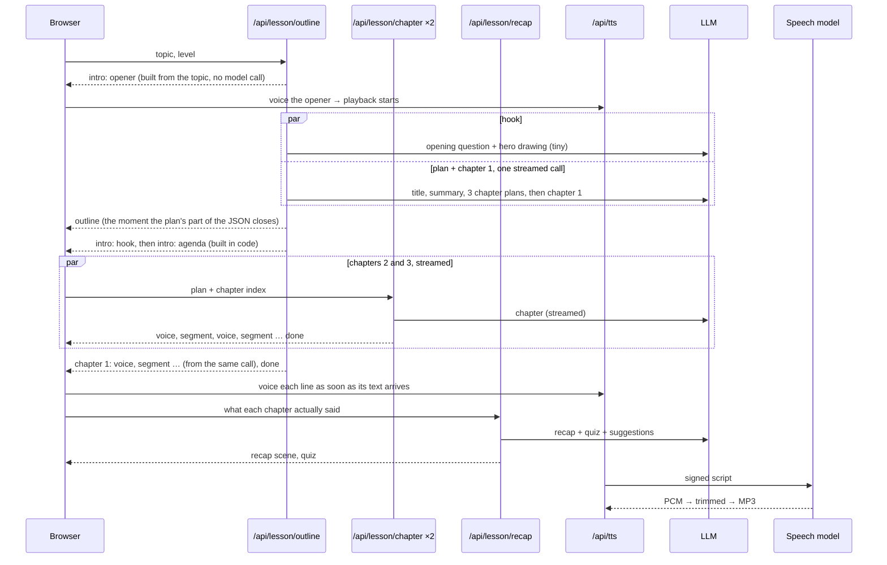
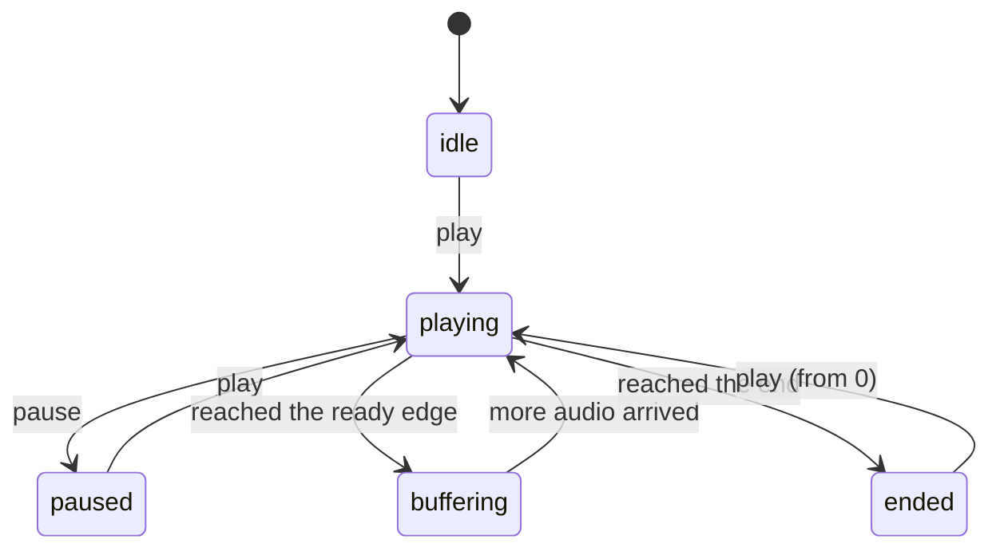

# ChalkTalk architecture

This document explains how a topic becomes a narrated, hand-drawn lesson, and why the main pieces are built the way they are. For a feature overview, see the [README](../README.md).

- [1. Request flow](#1-request-flow)
- [2. The board script](#2-the-board-script)
- [3. Layout engine](#3-layout-engine)
- [4. Timeline and synchronisation](#4-timeline-and-synchronisation)
- [5. Rendering](#5-rendering)
- [6. Player](#6-player)
- [7. Streaming generation](#7-streaming-generation)
- [8. Voice](#8-voice)
- [9. Tutor answers](#9-tutor-answers)
- [10. Failure handling](#10-failure-handling)
- [11. Testing](#11-testing)

## 1. Request flow



The browser orchestrates (`src/lib/client/session.ts`): it knows what is still missing, retries individual chapters, reports progress, and keeps each serverless call short. All model calls happen on the server, so the API key never reaches the browser.

## 2. The board script

The model never outputs coordinates in pixels or SVG. It writes a small, typed board script (`src/lib/lesson/schema.ts`):

```jsonc
{
  "narration": "Picture a leaf in sunlight. It takes in light from the sun, water from the roots, and carbon dioxide from the air.",
  "actions": [
    { "id": "leaf", "kind": "icon", "icon": "leaf", "text": "Leaf", "at": { "col": 5, "row": 2, "w": 2, "h": 2 }, "cue": "Picture a leaf", "color": "green" },
    { "id": "sun",  "kind": "icon", "icon": "sun",  "text": "Light", "at": { "col": 1, "row": 0, "w": 2, "h": 2 }, "cue": "light from the sun", "color": "orange" },
    { "id": "a1",   "kind": "arrow", "from": "sun", "to": "leaf", "cue": "light from the sun" }
  ]
}
```

| Group | Kinds |
| --- | --- |
| Elements (take space) | `text`, `note`, `box`, `circle`, `icon`, `sketch`, `list`, `flow`, `cycle`, `timeline`, `plot`, `bars`, `pie`, `compare`, `number`, `particles` |
| Connectors | `arrow`, `line` |
| Annotations (target an element, or `id[index]` for a part of a list/flow/cycle/chart) | `highlight`, `circle_around`, `underline`, `cross_out`, `check`, `callout`, `pulse`, `trace` |
| Motions (make an element on the board move) | `orbit` (around `to`), `spin`, `swing`, `move` (over to `to`), `vibrate`, `grow` |

`bars` is a bar chart from items such as `"Year 1: $110"` (bars grow, values count up); `pie` takes shares such as `"Water: 80"` (wedges sweep open, with a legend of percentages); `compare` is a table whose items are rows like `"Plants | Animals"` (the first row is the header); `timeline` takes events such as `"1905: Special relativity"` (short dates become numbered stops); `number` is one key quantity that counts up as it appears; `particles` is a box of jiggling dots (`expr` like `"16 fast"`) for gases, heat or diffusion. `pulse` sends rings out from its target; `trace` sends a dot, or a small icon or word, along an arrow, flow or cycle, or flying from one element to another (`from`, `to`).

`sketch` is the model's own figure, for when no ready-made drawing fits: up to 12 shapes in a 0–100 square, one per item, such as `circle 50 50 20`, `fill blue rect 10 60 80 10`, `orange arrow 40 10 40 75`, `curve 10 80 30 20 50 60`, `arc 50 50 38 270 293`, `text 50 95 label` or SVG path data. Shapes are parsed from numbers into fresh path strings in board coordinates (`src/lib/board/sketch.ts`), so nothing the model writes reaches the page as markup, and a shape with a missing number is skipped rather than drawn wrongly.

Design choices:

- **Flat actions with nullable fields** instead of a discriminated union. Every field is always present (`null` when unused), which strict structured-output modes accept across providers. Per-kind rules are enforced afterwards.
- **zod is the single source of truth.** `toStrictJsonSchema()` converts the zod schema into the strict JSON Schema sent with each request (all properties required, `additionalProperties: false`, nullables as type unions), and the same zod schema validates the response.
- **Repair, not rejection** (`src/lib/lesson/repair.ts`). After validation, each action is made sensible: narration is stripped of anything unspeakable, ids are sanitised and de-duplicated, actions missing required fields are dropped, label lengths are capped, icon names are resolved through aliases (`water` → `droplet`), bars without numbers become a list and numbers without digits become text, pies and timelines with fewer than two items and tables without two `|` rows become lists, a sketch with no shapes becomes a box, motions without something to move (or an orbit or move without a destination) are dropped, and if a cue phrase doesn't occur in the narration it is re-anchored to the element's label when that is spoken.

## 3. Layout engine

`src/lib/board/layout.ts` turns actions into drawable elements on a 1600 × 900 board:

1. **Grid placement.** A title band on top, then a 12 × 6 grid. An element goes where the model asked if those cells are free; otherwise to the nearest free slot of the same size (shrinking gradually if needed). The model's spatial intent is respected while overlaps are prevented.
2. **Text fitting.** Widths come from a per-glyph table measured from the handwriting font in a browser (with a small safety margin), so layout is deterministic and testable without a DOM. Text shrinks and wraps to fit its box.
3. **Composites.** Lists, flows (horizontal or vertical depending on the box), cycles (nodes on an ellipse, arcs trimmed outside the nodes), plots (axes, a curve sampled from a safe expression parser, robust y-range, a shaded area under unbroken curves) and bar charts (an axis plus one bar per item, scaled to the largest value) are laid out by code and broken into sub-elements (`flow.2`, `flow.a1`, `chart.1`, …) that can be targeted and revealed one by one.
4. **References.** Arrows and annotations resolve targets by id, by `id[index]`, or by label text. Unknown references are dropped with a warning (visible in `/playground`) rather than drawn wrongly. Each connector, annotation and trace records what it refers to (`deps`), and the elements an emphasising annotation points at (`targets`).
5. **Hand-drawn strokes.** rough.js's generator is DOM-free, so sketchy paths are computed once during layout with a fixed seed per element; frames never re-randomise. Shapes get a light **hand-hatched fill** in their colour (rough.js hachure), icons and key numbers a pale colour spot, sticky notes a soft shadow; labels over hatching get a paper-coloured halo so they stay crisp.
6. **Arrow routing.** Arrows attach to the facing edges of what they join. Two connectors between the same pair (there and back) are offset to either side of the line between them, with their labels on the outer sides. When two elements sit too close for a straight arrow to read (or to point the right way), the arrow becomes a curve that leaves one drawing at the side and loops into the other.
7. **Motions.** A motion action draws nothing itself (an orbit draws its dotted ring) and records which elements move and how. An orbit's ring passes through the element's position, squashed into an ellipse so it reads as a tilted circle; if it would leave the board it is pulled in, and the element glides onto it as it starts to travel. Elements with a caption keep the bounds of the drawing alone (`art`), so a spin or a swing pivots on the drawing, not on the caption.

Each element is a list of **parts** (`stroke`, `fill`, `text`, `icon`, `dot`, `flow`, `ripple`, `bar`, `count`, `wedge`, `particles`), each revealed during a sub-interval `[a, b]` of the element's progress. A labelled box, for example, draws its outline during `[0, 0.42]`, is coloured in during `[0.36, 0.62]` and writes its label during `[0.55, 1]`.

## 4. Timeline and synchronisation

`src/lib/board/timeline.ts` compiles scenes plus audio durations into absolute times:

- **Segments** are laid end to end: start = previous end + 0.35 s (1.1 s between boards, with an erase animation in that gap). Durations come from the decoded audio, so segment boundaries are exact.
- **Cues inside a segment.** An action starts at `segment.start + f · duration − 0.15 s`, where `f` is the fraction of the narration spoken before the cue phrase. `f` is weighted by how long characters take to say: letters 1, spaces 0.55, commas 3, full stops 5.5, because speech pauses at punctuation. The 0.15 s lead makes the drawing begin as the word is said, like a teacher's hand.
- **Composites spread out** across the rest of their segment, so list items and flow steps appear as they are talked through.
- **Dependencies.** Nothing starts before what it refers to is on the board: an arrow waits for both ends, an annotation for its target, a travelling token for its path. This also protects against cues the model put slightly out of order.
- **Emphasis.** When a `pulse`, `circle_around`, `check` or `callout` starts, its target gets a short bump (scale 1 → 1.07 → 1).
- **Motions** are attached to the elements they move and begin when the motion action is drawn, on its cue. Orbits, spins, swings and vibrations keep going for the rest of the board; a move or a grow plays once and holds its end state.
- **Camera** (`src/lib/board/camera.ts`). Each board gets a planned list of camera moves: drawings that start within 1.5 s of each other are framed together (a whole diagram as it builds, an arrow together with both ends); the camera eases in (at most 1.32×) about 0.45 s before the pen lands, holds still while new drawing already fits in view, drifts back to the whole board when the narration stops drawing for a few seconds, waits for the title to be written, and always shows the whole board before it's erased. Moves are interpolated with an ease-in-out curve; a move that starts mid-move starts from where the camera actually is, so there are no jumps.
- **Readiness.** The timeline records `readyUntil`: the end of the last contiguous segment that has audio (or has definitively fallen back to silence). Boards still being generated reserve estimated time, so the seek bar can show them in advance. A board that is partially streamed is playable up to its last segment.

The board at any moment is a pure function, `frameAt(timeline, t)` in `src/lib/board/state.ts`: the active scene, each started element with its progress `p ∈ (0, 1]` (eased like a hand: it speeds up and slows down but never stalls), its bump phase and its age since it finished, the camera view, the eraser progress, the segment being spoken and the current word for captions. Nothing about the drawing depends on history, which is why seeking backwards or forwards, pausing mid-stroke or switching tabs is exact, camera included.

## 5. Rendering

`src/components/board/` renders a frame as SVG:

- The camera is the SVG `viewBox`: moving it costs no React work and keeps every stroke crisp.
- Strokes use `pathLength="1"` and `stroke-dashoffset = 1 − p`: no path measurement needed. Hatching is revealed the same way, so shapes are "coloured in" stroke by stroke.
- Text is written left to right behind a clip rectangle, line by line, with a pen cursor at the edge.
- Line-art drawings (Lucide icons) are drawn sub-path by sub-path over their colour spot, which pops in first with a small overshoot. Sticky notes and ticks pop in the same way.
- Once an arrow is drawn, a glowing packet runs along it every few seconds, showing the direction of flow (cycles visibly turn). Travelling tokens leave a short comet tail; `pulse` draws two expanding rings; bars grow from the axis with a little overshoot while their values count up; numbers count up from zero (years and the like are written, not counted).
- Motions are SVG transforms from `motionTransform()` (`src/lib/board/motion.ts`), a pure function of time: moves and orbits translate the whole element, while spins and swings rotate only the drawing, so captions stay upright. Particles get their positions from time with a seeded random generator and reflection off the walls of their box, so seeking lands on exactly the same frame.
- Finished elements are memoised (`p` stays at 1); only elements that keep moving (flowing arrows, particles, moving elements) re-render every frame. There are no SVG filters, which are expensive to repaint while the camera moves. With 4× CPU throttling, playback holds 60 fps in our tests.
- Clickable elements (anything with a label) become focusable buttons with an "Ask about …" label.
- With `prefers-reduced-motion`, elements appear fully drawn at their cue, nothing keeps moving (a move or a grow shows its end state) and the camera stays on the whole board.

## 6. Player

`src/lib/player/player.ts` is a small state machine with no React dependency:



- **The clock is the audio hardware clock.** While playing, lesson time = anchor + (`AudioContext.currentTime` − anchor clock) − output latency. Audio for every loaded segment is scheduled sample-accurately with `AudioBufferSourceNode.start(when, offset)`. The visual clock is delayed by the output latency (Bluetooth headphones can add 200 ms or more), so drawings match what you hear.
- **Seek** stops all sources and reschedules from the new time; **pause** records the time and stops; **resume** reschedules. If the context can't run, the player uses a wall clock and plays silently with captions.
- **Growing timelines.** When new segments arrive, sources whose start moved are rescheduled and new buffers are scheduled. If playback reaches `readyUntil` it waits there (`buffering`) and resumes on its own.
- **Browser quirks.** The `AudioContext` is unlocked inside the click that starts a lesson, and a silent looping `<audio>` element keeps iOS in "playback" mode so Web Audio is audible even with the ringer switched off.

## 7. Streaming generation

The model spends several hundred reasoning tokens on every call (much longer when the provider is busy), so a lesson can only start fast, and never pause, if no line ever waits on a model round trip it doesn't need. Six decisions get there:

1. **An instant opener.** The first line ("Good question. Why do we have seasons? Let's figure it out together.") is built from the topic in code and sent before any model call, so the voice starts within a few seconds of the click.
2. **Hook ∥ plan + chapter 1.** Two model calls run in parallel: a tiny hook (an opening question and a hero drawing) and one call that writes the plan *and then chapter 1* (`PlanSchema`). `PlanStream` (`src/lib/lesson/segment-stream.ts`) emits the outline the moment the plan's `chapters` array closes, which starts chapters 2 and 3 in parallel, while chapter 1 keeps streaming from the same call. That removes a whole round trip from the path to chapter 1. If the hook lags the plan by more than 2.5 s it is skipped.
3. **The agenda is code.** "Here's our plan. First, … Then, … And finally, …" is built from the chapter titles, so it costs no model call and can't disagree with the plan.
4. **Chapters stream, narration first.** `streamStructured()` streams the model's JSON, and `ArrayItemExtractor` (`src/lib/lesson/stream-json.ts`) pulls out each segment object as soon as its closing brace arrives (it tracks strings and escapes, so braces inside text don't confuse it). Before that, `SegmentStream` announces each line's narration (`{"voice"}`, signed) the moment its JSON string closes, so the line is being voiced while the model is still writing its drawings. Each finished segment is validated, repaired, signed and sent as an NDJSON line.
5. **Voice in lesson order, next line first.** The client keeps one voice job per line, in lesson order, with up to five requests in flight. The next two lines from the playhead may run beyond that limit, so the line about to be heard never waits behind later chapters.
6. **Small audio.** Speech travels as 48 kbps MP3 (25–75 KB a line instead of ~400 KB of raw PCM), so lines arrive quickly on phones.
7. **The fastest endpoint.** OpenRouter serves Hydrogen from several Google endpoints, and they differ a lot. Pinned one at a time and measured together, the first word arrived in 3–4 s on Google AI Studio's standard tier, 6–14 s on its flex tier, 5–17 s on Vertex (global, US, priority) and 47–70 s on Vertex EU. Left to choose, OpenRouter could try a Vertex endpoint first and wait ~10 s for a timeout before falling back. So Google models ask for AI Studio first (`MODEL_PROVIDERS`), with every other endpoint kept as a fallback. With it, the hook arrives in 2–5 s and chapter 1's first line in 9–13 s, against 9–20 s and 12–25 s before.

The recap and quiz are written from the chapters' actual narration (not just the plan), after all chapters arrive — long before playback reaches them.

## 8. Voice

The narrator is **Gemini TTS** (`google/gemini-3.8-flash-tts`), called through OpenRouter's text-to-speech endpoint (`/api/v1/audio/speech`, see `synthesizeSpeech` in `src/lib/server/openrouter.ts`). It is a true text-to-speech model that reads the script verbatim, with the teacher's tone set by a delivery instruction (`TTS_STYLE`). It returns raw 16-bit PCM at 24 kHz (`audio/pcm;rate=24000`); after trimming silence the server encodes it as 48 kbps mono MP3 with LAME compiled to WebAssembly (`src/lib/server/mp3.ts`, about 60 ms a line), and the browser decodes it with `decodeAudioData`. Because everything goes through OpenRouter, one key covers the lesson model and both voices.

If the narrator fails for a line, the backup narrator is an audio-output chat model (`openai/gpt-audio-mini`). It is conversational by nature, so `src/lib/server/tts.ts` makes it behave like a strict TTS:

- It is prompted as a voice actor reading a quoted script, and its **transcript is compared with the script** (normalised word edit distance).
- If it read the script and kept talking, the audio is **cut at the quietest pause** near where the script ends, with a short fade. Real mismatches are retried (up to three attempts, keeping the closest).
- Leading and trailing silence is trimmed, which keeps segment timing tight.
- Each line has a **time budget** that fits the speech route's 60-second limit. The narrator gets up to 30 seconds (it is retried once after a server error or a timeout), and the backup voice gets the rest. A bad request or a 429 (quota used up) is not retried: the backup voice takes over right away.
- Only text **signed with HMAC** by the server that generated it can be voiced, so the endpoint is not a free TTS API. The signature covers the voice too, so the same URL always maps to the same voice and responses can be `immutable` and CDN-cached; audio from the backup voice is cached for only five minutes, so the primary voice takes over again once it recovers.
- If the speech provider is unavailable, the client switches to a **browser-voice fallback** (`src/lib/player/narrator.ts`). Each voiceless line is spoken when its segment starts (from the current word after a seek), and the player holds the board at the segment boundary until the line finishes, so drawings never run ahead of the voice.

## 9. Tutor answers

When the learner asks (`/api/ask`), the request carries:

- the lesson title, the current board's title and the timestamp;
- the last ~90 words that were spoken;
- every element on the board at that moment (id, kind, label);
- the element the learner clicked, if any;
- the last few questions and answers.

The model chooses a mode:

- `annotate`: mark up the current board (circle, highlight, callout, arrows between existing ids) and add up to three small elements in free cells.
- `new_board`: draw a fresh mini-board.
- `chat_only`: just answer in chat; the reply is still spoken.

The answer is compiled as its own small timeline whose **base** is the paused board. The layout engine treats base elements as occupied cells and valid reference targets, so new elements land in free space and annotations can target what's already drawn. It plays with its own player, and "Back to the lesson" resumes the main timeline exactly where it was paused. Answers also report a confidence; low-confidence answers say so in the chat.

## 10. Failure handling

| Failure | What happens |
| --- | --- |
| Model returns JSON that doesn't validate | Retried once with the validation errors; then repaired action by action |
| A chapter fails to generate | Retried; if it still fails the lesson skips it and the chapter list offers "retry" |
| A chapter stream breaks midway | Segments that already arrived are kept; the lesson continues |
| The connection drops (a phone tab in the background, a network blip) | Never fatal. Before the plan arrives, the plan request is retried; after it, the lesson carries on and chapter 1 is fetched on its own. Chapters, the recap and voice lines are retried once the page is visible again, and a dropped voice request doesn't count as a failed attempt |
| The Gemini voice fails for a line | The backup voice reads that line; its audio is cached for only five minutes |
| A line can't be voiced at all | Up to two attempts; then the browser voice reads it (captions stay on) |
| Speech provider unavailable | Detected once; remaining lines use the browser voice without further requests |
| Playback catches up with generation | "The tutor is preparing the next part…"; resumes automatically |
| Unsafe topic | Declined with a short explanation and a prompt to choose another topic |
| Too many requests from one client | HTTP 429 with a friendly wait message |
| Missing server configuration | HTTP 503 explaining the API key is missing |

## 11. Testing

`pnpm test` runs fast, deterministic unit tests (no network):

- **Layout:** every fixture element stays on the board; overlaps are resolved; out-of-range cells are clamped; composite parts and labels resolve as targets; unknown references are reported; arrows going there and back run side by side with their labels apart; elements too close for a straight arrow get a curved one that still points the right way.
- **Drawing tools:** sketch shapes map from the 0–100 square into their box (bad shapes are skipped) and a sketch is bounded by what's drawn; pies make a whole circle; tables have a header; timelines have one stop per event; an orbit's ring stays on the board and the element ends up riding exactly on it; spins and swings pivot on the drawing, not its caption; reduced motion stops continuous motions and finishes one-off ones.
- **Timing:** cue finding is tolerant of case and punctuation, fractions are monotonic, segments don't overlap, drawings start near their cue words, readiness stops at missing audio and at partially streamed boards.
- **`frameAt`:** the same frame for the same time regardless of history; elements hidden before their start and complete after their end; erasing before the next board; transient elements disappear; captions track the spoken word.
- **Camera and motion:** the view always stays on the board, keeps its shape and never zooms past the limit; every board starts and ends in full view; the view is a pure function of time; it holds still while new drawing already fits; annotated elements bump briefly; arrows keep flowing after they're drawn; tokens wait until both ends are drawn; bar charts and counting numbers parse and format their values.
- **Player** (fake audio clock): follows the audio clock, freezes on pause, schedules audio at the right offsets, seeks while playing or paused, waits for missing audio and resumes, never seeks past generated content, ends and restarts, compensates output latency, falls back to a wall clock, and drives the fallback narrator (including holding at segment ends).
- **Pipeline:** the streaming array extractor across arbitrary chunk boundaries, the plan stream (outline as soon as the plan closes, then chapter 1's segments) and early narration, the instant opener, narration cleaning, action repair (including bars without numbers and traces between two elements), id continuity across streamed segments, transcript classification (exact, close, ad-libbed ending, mismatch), speech audio parsing, the safe expression parser, provider routing, and merging intro lines from a retried plan stream (no repeated opener or second hook).

The `/playground` page renders a hand-written lesson through the same engine without any AI, which makes visual changes easy to check.
